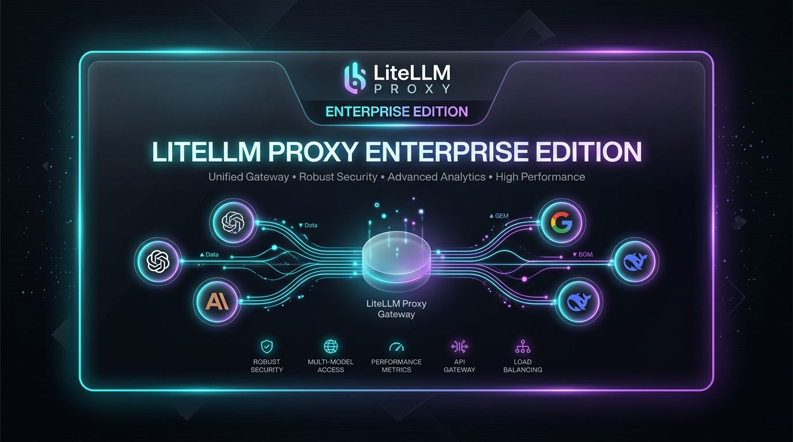
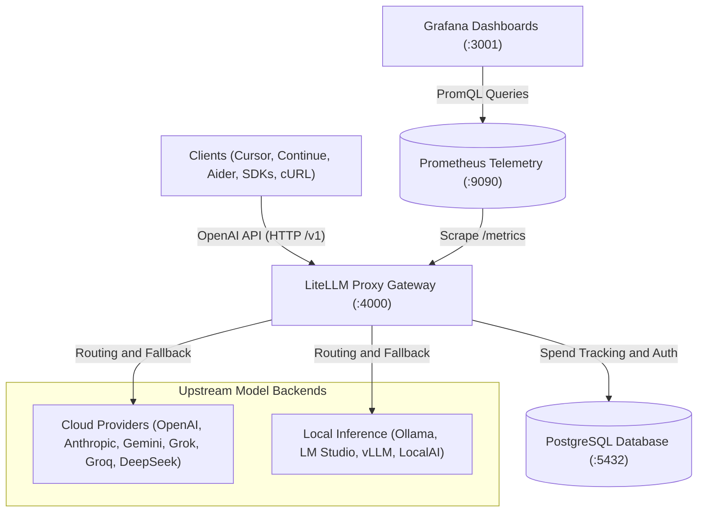

<p align="center">
  
</p>

# LiteLLM Proxy Gateway

A centralized, OpenAI-compatible LLM gateway with PostgreSQL virtual key management, Prometheus observability, and automated model failovers.

<p align="left">
  <a href="LICENSE.md"></a>
  <a href="https://github.com/BerriAI/litellm"></a>
  <a href="https://www.postgresql.org/"></a>
  <a href=".github/workflows/ci.yml"></a>
  <a href="SECURITY.md"></a>
  <a href=".pre-commit-config.yaml"></a>
</p>

---

## Table of Contents

- [Quick Start](#quick-start)
- [System Architecture](#system-architecture)
- [Makefile Command Reference](#makefile-command-reference)
- [Client and IDE Integration](#client-and-ide-integration)
- [API Test Collections](#api-test-collections)
- [Configuration and Validation](#configuration-and-validation)
- [Database Operations and Recovery](#database-operations-and-recovery)
- [Observability and Monitoring](#observability-and-monitoring)
- [Remote Ingress and Tunnels](#remote-ingress-and-tunnels)
- [Model Provider Keys](#model-provider-keys)
- [Technical FAQ](#technical-faq)
- [Repository Structure](#repository-structure)
- [Security and Governance](#security-and-governance)

---

## Quick Start

### Fast-Path (Docker Compose)

Deploy the entire stack in four commands:

```bash
# 1. Clone repository
git clone https://github.com/AtaCanYmc/home-lite-llm.git && cd home-lite-llm

# 2. Initialize environment configuration
cp .env.example .env

# 3. Launch gateway, database, and telemetry services
docker compose up -d

# 4. Verify proxy and database readiness
curl http://localhost:4000/health/readiness
```

### Interactive CLI Wizard

Alternatively, run the interactive onboarding script. It verifies system requirements, generates cryptographically secure keys, prompts for provider credentials, and starts the containers:

```bash
chmod +x quickstart.sh && ./quickstart.sh
```

For non-interactive headless environments, pass the `-y` flag:

```bash
./quickstart.sh -y
```

---

## System Architecture

LiteLLM Proxy unifies multiple LLM providers behind an OpenAI-compatible routing layer. PostgreSQL tracks API budgets, rate limits, and request logs. Prometheus scrapes gateway telemetry for visualization in Grafana.



### Key Architectural Constraints
- **Database Isolation**: PostgreSQL port `5432` binds strictly to the internal Docker network `litellm-network`. It is never published to host network interfaces.
- **Failover Chains**: If a primary upstream provider fails or returns HTTP 429, the router immediately redirects the request to configured fallback models (e.g. `gpt-4o` -> `gemini-2.0-flash` -> `claude-3-5-sonnet`).
- **Disk Protection**: Docker logging uses the `json-file` driver with strict rotation policies (`max-size: 10m`, `max-file: 3`) to prevent host storage exhaustion.

---

## Makefile Command Reference

A `Makefile` is provided to standardize deployment, diagnostics, and database operations into single-word commands:

| Command | Category | Operational Function |
| :--- | :--- | :--- |
| `make up` | Lifecycle | Starts all stack containers in detached mode |
| `make down` | Lifecycle | Stops running containers without removing volumes |
| `make restart` | Lifecycle | Restarts all gateway containers |
| `make build` | Lifecycle | Rebuilds images and recreates containers |
| `make clean` | Lifecycle | Stops services and deletes persistent database volumes |
| `make quickstart` | Lifecycle | Launches the interactive configuration wizard |
| `make ps` | Monitoring | Lists status and healthcheck states of all containers |
| `make logs` | Logging | Streams interleaved logs from all running services |
| `make logs-litellm` | Logging | Streams live output from the proxy container |
| `make logs-db` | Logging | Streams live output from the PostgreSQL container |
| `make logs-grafana` | Logging | Streams live output from the Grafana container |
| `make validate` | Diagnostics | Executes configuration syntax and credential audit |
| `make health` | Diagnostics | Probes `/health/readiness` endpoint for gateway uptime |
| `make test-models` | Diagnostics | Authenticates and queries the active `/v1/models` list |
| `make backup` | Database | Dumps and compresses database into `./backups/*.sql.gz` |
| `make restore FILE=...` | Database | Restores database from a compressed or plain SQL dump |
| `make lint` | Quality | Executes pre-commit hooks and YAML linters |
| `make help` | Help | Displays colored menu of all available targets |

---

## Client and IDE Integration

The proxy exposes an OpenAI-compliant API endpoint at `http://localhost:4000/v1`. Detailed, copy-paste configuration templates for popular coding environments are maintained in [`docs/INTEGRATION_GUIDE.md`](docs/INTEGRATION_GUIDE.md):

- **Cursor IDE**: Override OpenAI Base URL with `http://localhost:4000/v1` and supply `MASTER_KEY`.
- **Continue.dev**: Complete `~/.continue/config.json` configuration for chat, edit, autocomplete, and embeddings.
- **Cline / Roo Code**: VS Code autonomous coding agent configuration using OpenAI Compatible provider mode.
- **Aider**: Command-line flags and `.aider.conf.yml` templates for terminal pair programming.
- **Web UIs**: Container integration recipes for Open WebUI and LibreChat.

---

## API Test Collections

Ready-to-use API collections are available in the [`collections/`](collections/) directory:

```text
collections/
├── postman/
│   ├── LiteLLM_Gateway.postman_collection.json         # Postman collection (v2.1)
│   └── LiteLLM_Local_Environment.postman_environment.json # Postman environment template
└── bruno/
    ├── bruno.json                                      # Bruno collection definition
    ├── collection.bru                                  # Global Bearer token configuration
    ├── environments/Local.bru                          # Bruno local environment variables
    ├── 01-health-check.bru                             # Readiness check probe
    ├── 02-list-models.bru                              # List active models
    ├── 03-chat-gpt4o.bru                               # GPT-4o completion
    ├── 04-chat-claude.bru                              # Claude 3.5 Sonnet completion
    ├── 05-chat-gemini.bru                              # Gemini 2.0 Flash completion
    ├── 06-chat-deepseek.bru                            # DeepSeek Chat completion
    ├── 07-chat-grok.bru                                # xAI Grok 2 completion
    ├── 08-chat-groq.bru                                # Groq Llama 3.3 70B completion
    ├── 09-chat-local-ollama.bru                        # Ollama local inference
    ├── 10-chat-local-lmstudio.bru                      # LM Studio local inference
    ├── 11-chat-local-vllm.bru                          # vLLM GPU inference server
    ├── 12-streaming-chat.bru                           # Server-Sent Events stream
    └── 13-generate-virtual-key.bru                     # Admin virtual key generation
```

Refer to [`collections/README.md`](collections/README.md) for import and variable setup instructions.

---

## Configuration and Validation

Validate model mappings, router fallback targets, and environment credentials using `scripts/validate_config.py`:

```bash
# Standard validation pass
make validate

# Enforce strict zero-placeholder policy
python3 scripts/validate_config.py --strict

# Output machine-readable JSON for CI pipelines
python3 scripts/validate_config.py --json
```

### Verification Checks
- Ensures `config.yaml` is well-formed YAML.
- Confirms every model in `router_settings.fallbacks` exists in `model_list`.
- Audits `.env` to detect unset placeholders or missing credentials.

---

## Database Operations and Recovery

Virtual API keys, team budgets, and historical token usage persist in PostgreSQL. Operational backup scripts are located in [`scripts/`](scripts/).

### Creating Backups
```bash
# Generate timestamped archive in ./backups/
make backup
```

### Restoring from Backup
```bash
# Restore specific archive with confirmation prompt
make restore FILE=backups/litellm_backup_20260901_025639.sql.gz
```

### Automated Daily Backup Schedule (Crontab)
To execute automated backups at 02:00 AM daily:

```bash
crontab -e
```

Add the following line:

```cron
0 2 * * * cd /path/to/home-lite-llm && ./scripts/backup_db.sh -q >> /var/log/litellm_backup.log 2>&1
```

---

## Observability and Monitoring

The stack provisions an integrated telemetry pipeline accessible via standard browser ports:

| Service | Target URL | Authentication | Capabilities |
| :--- | :--- | :--- | :--- |
| **LiteLLM Admin UI** | `http://localhost:4000/ui` | Bearer `MASTER_KEY` | Virtual key provisioning, budget allocation, live log viewer |
| **Grafana Dashboard** | `http://localhost:3001` | Default: `admin` / `admin` | Visual graphs for RPS, token usage, latency (P50/P99), error rates |
| **Prometheus Server** | `http://localhost:9090` | None (Internal) | PromQL exploration, scrape target health (`litellm-proxy`) |
| **Metrics Endpoint** | `http://localhost:4000/metrics` | None | OpenMetrics telemetry stream consumed by Prometheus |
| **Readiness Probe** | `http://localhost:4000/health/readiness` | None | Status check verifying proxy and database responsiveness |

---

## Remote Ingress and Tunnels

Access your gateway remotely without opening firewall ports or acquiring a static public IP. Comprehensive setup guides are documented in [`tunnels/README.md`](tunnels/README.md):

| Technology | Security Model | Ingress Scope | Setup Reference |
| :--- | :--- | :--- | :--- |
| **Cloudflare Tunnel** | High | Public HTTPS via custom domain | [Cloudflare Setup](tunnels/cloudflare/README.md) |
| **ngrok** | Medium | Ephemeral public testing URL | [ngrok Setup](tunnels/ngrok/README.md) |
| **Tailscale** | Highest | Authenticated zero-trust mesh VPN | [Tailscale Setup](tunnels/tailscale/README.md) |
| **Port Forwarding** | Low | Direct router NAT exposure | [Port Forwarding Setup](tunnels/port-forwarding/README.md) |

---

## Model Provider Keys

Configure credentials for desired providers in `.env`. The gateway routes requests based on which keys are populated:

| Provider | Portal Dashboard | Pricing Model | Setup Procedure |
| :--- | :--- | :--- | :--- |
| **Google Gemini** | [aistudio.google.com](https://aistudio.google.com/app/apikey) | Free tier available | Create API key and assign to Google Cloud project |
| **Groq** | [console.groq.com](https://console.groq.com/keys) | Free tier available | Generate API key in Groq console |
| **Ollama** | [ollama.com](https://ollama.com) | Free (Self-hosted) | Run Ollama locally on host port 11434 |
| **vLLM** | [vllm.ai](https://vllm.ai) | Free (Self-hosted) | Launch OpenAI-compatible server on host port 8000 |
| **OpenRouter** | [openrouter.ai](https://openrouter.ai/keys) | Free and paid models | Create account key from Keys dashboard |
| **OpenAI** | [platform.openai.com](https://platform.openai.com/api-keys) | Pay as you go | Create secret key in API keys tab |
| **Anthropic** | [console.anthropic.com](https://console.anthropic.com/settings/keys) | Pay as you go | Create key in Anthropic console |
| **DeepSeek** | [platform.deepseek.com](https://platform.deepseek.com/api_keys) | Pay as you go | Create API key in DeepSeek portal |
| **xAI (Grok)** | [console.x.ai](https://console.x.ai) | Pay as you go | Create API key in xAI console |
| **Mistral AI** | [console.mistral.ai](https://console.mistral.ai/api-keys) | Pay as you go | Create new key under workspace settings |
| **Perplexity AI** | [perplexity.ai](https://perplexity.ai/settings/api) | Pay as you go | Generate key from API settings |
| **Together AI** | [api.together.ai](https://api.together.ai/settings/api-keys) | Trial credits and paid | Copy key from account settings |
| **Fireworks AI** | [fireworks.ai](https://fireworks.ai/account/api-keys) | Trial credits and paid | Create key in user profile |
| **Cohere** | [dashboard.cohere.com](https://dashboard.cohere.com/api-keys) | Trial and production keys | Copy trial key or generate production key |
| **Azure OpenAI** | [portal.azure.com](https://portal.azure.com) | Azure subscription | Copy endpoint, key, and deployment version |
| **AWS Bedrock** | [console.aws.amazon.com](https://console.aws.amazon.com/iam) | AWS billing | Provision IAM access keys with Bedrock permissions |

---

## Technical FAQ

#### How does LiteLLM secure virtual API keys?
Virtual API keys are salted and hashed using bcrypt before insertion into the PostgreSQL database (`STORE_MODEL_IN_DB=True`). Raw plaintext keys are only returned once during initial generation.

#### How do Docker containers reach local host services like Ollama?
The proxy reaches services running directly on the host machine using `host.docker.internal`. For Linux hosts without default host gateway mappings, ensure `OLLAMA_HOST=0.0.0.0` is configured so Ollama binds to all network interfaces.

#### What happens when an upstream provider rate limits a request?
LiteLLM detects HTTP 429 status codes and immediately transitions to the next model in the configured fallback chain without returning an error to the client.

#### Can LiteLLM run without internet access?
Yes. If only local models (`ollama-*`, `lmstudio-local`, `vllm-*`) are queried and credentials for cloud providers are omitted, LiteLLM operates fully offline.

---

## Repository Structure

```text
├── .editorconfig                               # Cross-editor formatting specifications
├── .gitattributes                              # Git line ending normalization rules
├── .gitignore                                  # Git file exclusions
├── .markdownlint.json                          # Markdown linting configuration
├── .pre-commit-config.yaml                     # Pre-commit quality hooks
├── .yamllint.yml                               # YAML syntax and formatting rules
├── CHANGELOG.md                                # Semantic release history
├── CODE_OF_CONDUCT.md                          # Contributor standards
├── CONTRIBUTING.md                             # Contribution instructions
├── LICENSE.md                                  # MIT license terms
├── Makefile                                    # Lifecycle and operational targets
├── README.md                                   # Root repository documentation
├── SECURITY.md                                 # Security policy and disclosure process
├── SUPPORT.md                                  # Diagnostic and troubleshooting guide
├── config.yaml                                 # LiteLLM model routing and fallback rules
├── docker-compose.yml                          # Container orchestration definition
├── quickstart.sh                               # Interactive setup wizard
├── collections/                                # API test collections
│   ├── README.md                               # Collection documentation
│   ├── postman/                                # Postman collection and environment
│   └── bruno/                                  # Bruno request files
├── docs/                                       # Extended technical guides
│   └── INTEGRATION_GUIDE.md                    # IDE, CLI, and SDK integration guide
├── monitoring/                                 # Observability configurations
│   ├── prometheus.yml                          # Prometheus scrape configurations
│   └── grafana/provisioning/                   # Grafana datasource manifests
├── scripts/                                    # Maintenance and backup utilities
│   ├── README.md                               # Scripts guide
│   ├── backup_db.sh                            # Database backup script
│   ├── restore_db.sh                           # Database restore script
│   └── validate_config.py                      # Configuration validator
└── tunnels/                                    # Remote ingress configurations
    ├── README.md                               # Tunnel comparison guide
    ├── cloudflare/                             # Cloudflare tunnel overlay
    ├── ngrok/                                  # ngrok tunnel overlay
    ├── tailscale/                              # Tailscale overlay
    └── port-forwarding/                        # Dynamic DNS and router forwarding
```

---

## Security and Governance

- **License**: MIT License. See [LICENSE.md](LICENSE.md) for legal text.
- **Vulnerability Disclosure**: Follow the private disclosure protocol in [SECURITY.md](SECURITY.md).
- **Contribution Standards**: Review [CONTRIBUTING.md](CONTRIBUTING.md) and adhere to [Conventional Commits](https://www.conventionalcommits.org/).
- **Code of Conduct**: Community interaction standards are governed by [CODE_OF_CONDUCT.md](CODE_OF_CONDUCT.md).
